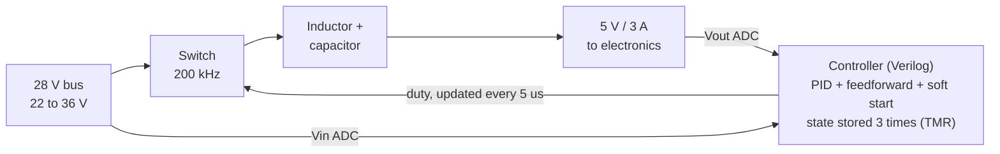
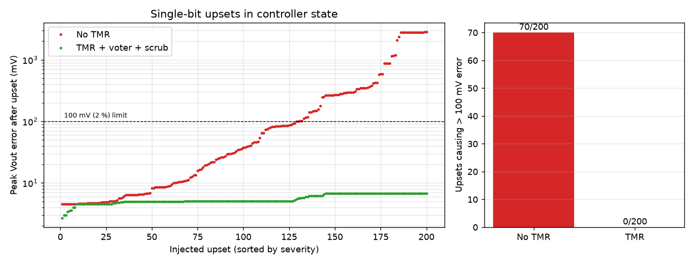
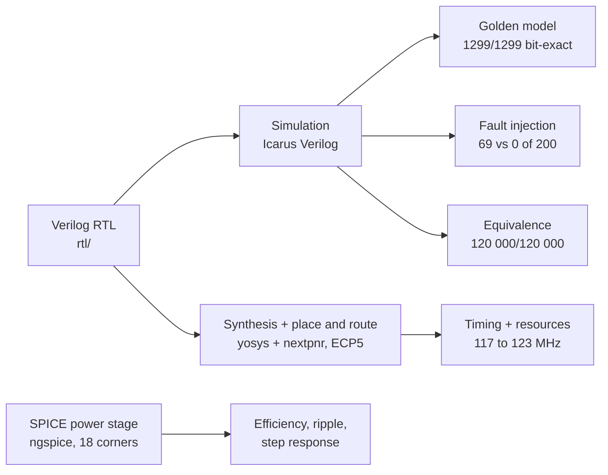

<div align="center">

# Spacecraft 28 V Bus Buck Converter

**Power stage, digital control and a radiation-tolerant controller: 28 V spacecraft bus in, a steady 5 V / 3 A out.**


-purple)


</div>

---

## At a glance

| | |
|---|---|
| **What** | 28 V (22 to 36 V) to 5 V / 3 A buck converter for a spacecraft power bus |
| **Power stage** | Sized and checked across 18 corners in SPICE |
| **Controller** | Fixed-point PID with Vin feedforward and soft start, written as synthesisable Verilog |
| **Verification** | Bit-exact against a Python golden model, plus an equivalence check between two controller architectures |
| **Radiation** | Triple modular redundancy (TMR) with voting and scrubbing, tested with 200 random bit flips |
| **FPGA** | Synthesised, placed and routed for a Lattice ECP5, meets a 100 MHz clock |
| **Hardware** | None. No board has been built or programmed (see [Limitations](#limitations)) |


---

## How it works, in one picture



Every switching period the controller samples Vout and Vin, works out a new **duty** (the fraction of time the switch is on) and applies it to the next period. A buck gives `Vout = D x Vin`, so roughly 18 % duty from 28 V gives 5 V.

---

## Headline results

| Item | Result |
|---|---|
| Efficiency, 3 A, 22 to 36 V (SPICE, conduction losses only) | **91.1 to 92.4 %** |
| Output ripple, worst of 18 corners (SPICE) | **18 mV pk-pk** |
| Steady-state regulation (Verilog closed loop) | **5.002 V** |
| Worst-case phase / gain margin | **46 deg / 7.2 dB** |
| Load step excursion / settling | 203 to 207 mV / 226 to 229 us (target 250 mV) |
| Line step excursion (28 to 22, 22 to 36, 36 to 28 V) | 31 / 60 / 23 mV (target 250 mV) |
| Start-up with 0.8 ms soft start | 73 mV overshoot, 4.4 A peak inductor current |
| RTL vs Python golden model | **1299 / 1299 ticks identical** |
| Multi-cycle vs single-cycle controller | **120 000 / 120 000 updates bit-identical** |
| FPGA timing, ECP5 LFE5U-25F, 100 MHz target | **116.6 to 123.0 MHz** over 3 seeds (single-cycle: 4.7 MHz) |
| FPGA resources (multi-cycle) | 754 LUTs (3 %), 783 FFs, 4 of 28 DSPs |
| Bit flips causing > 100 mV error, **no TMR** | 69 / 200 (worst 5.7 V) |
| Bit flips causing > 100 mV error, **with TMR** | **0 / 200** (worst 6 mV) |

---

## What changed, iteration by iteration

The commit history tells this story (`git log --oneline`).

| Iteration | Change | Problem it fixed | Result |
|---|---|---|---|
| **1** | 47 uF output capacitor, first PID tune | (baseline) | Load steps bounced **430 to 1010 mV** |
| **2** (`ff64d02`) | 150 uF capacitor + retuned PID | Load step excursion | Load steps down to **203 to 207 mV** |
| **3** (`10d12ff`) | **Vin feedforward** | 22 to 36 V bus step gave 438 mV | Line step **438 to 60 mV** |
| **3** (`10d12ff`) | **Soft start** ramp, 0.8 ms | Start-up overshoot 1079 mV, 10.3 A inrush | **73 mV, 4.4 A** |
| **FPGA** (`f5ffd2f`) | **Multi-cycle controller** | Single-cycle RTL only reached 4.7 MHz | **117 to 123 MHz**, meets 100 MHz |
| **FPGA** (`f5ffd2f`) | **`keep_hierarchy` on TMR copies** | Synthesis silently merged the 3 copies into 1 | TMR survives synthesis: 221 FFs, not 81 |
| **FPGA** (`f5ffd2f`) | **Equivalence check** | Proving the rewrite didn't change the maths | 120 000 / 120 000 identical |


---

## Three stories worth reading

<details open>
<summary><b>1. The synthesis tool deleted the radiation protection</b></summary>

<br/>

The 70-bit controller state is stored three times for TMR, so it should need 3 x 70 = **210** flip-flops. Synthesis saw three registers always loaded with the same value from the same logic, decided they were duplicates, and **merged them into one copy**. No error, no warning.

The fault-injection simulation still showed TMR working perfectly, because it runs on the Verilog **before** synthesis. The chip itself would have had no redundancy.

**Caught by** counting flip-flops in the synthesis report. **Fixed by** putting each copy in its own `(* keep_hierarchy *)` module, [`rtl/tmr_copy.v`](rtl/tmr_copy.v).

| | Flip-flops (single-cycle build) |
|---|---|
| Without `keep_hierarchy` | 81 = 11 + 70 (two copies gone) |
| With `keep_hierarchy` | **221 = 11 + 3 x 70** |

**Lesson:** check the tool's output didn't optimise away a safety feature. Passing simulation is not the same as the chip having it.

</details>

<details>
<summary><b>2. 4.7 MHz to 117 MHz: splitting the maths over 15 clocks</b></summary>

<br/>

The PWM counts 500 steps per 200 kHz cycle, so the FPGA clock must run at **100 MHz**. The original controller (`pid_ctrl.v`) does the whole update, including a 48-bit divide for the feedforward, in **one clock**. Its critical path is about 214 ns (83 ns logic + 130 ns routing), so it only reaches **4.7 MHz**.

`pid_ctrl_seq.v` does the same maths over **15 clocks**: one quotient bit of the divide per clock, multiplies on the FPGA's DSP blocks. Critical path drops to about 8 ns: **117 to 123 MHz** across three placement seeds.

| | Single-cycle (`SEQ=0`) | Multi-cycle (`SEQ=1`) |
|---|---|---|
| Multipliers (of 28) | 15 | **4** |
| Logic cells | 7412 | **754** |
| Flip-flops | 221 | 783 (holds partial results between steps) |
| Critical path | 83 + 130 ns | 4.9 + 3.3 ns |
| Max clock | **4.7 MHz, FAIL** | **117 to 123 MHz, PASS** |

The controller still updates once every 5 us. 15 clocks at 100 MHz is 0.15 us, well inside the period.

</details>

<details>
<summary><b>3. Surviving radiation: TMR and 200 bit flips</b></summary>

<br/>

A charged particle can flip a stored bit (a single event upset, SEU). The controller remembers four numbers between ticks:

| State | Bits | Flips (of 200) | Caused > 100 mV (no TMR) |
|---|---|---|---|
| Duty | 10 | 29 | 8 |
| Soft start reference | 12 | 34 | 12 |
| Previous error | 16 | 46 | 12 |
| **Integrator** | 32 | 91 | **37** |

**TMR:** all 70 bits stored three times, a bitwise 2-of-3 vote on every read (`(a & b) | (b & c) | (a & c)`), and the voted value written back to all copies every period (**scrubbing**). A mismatch flag is raised for telemetry.

| 200 random single-bit flips | No TMR | TMR |
|---|---|---|
| Vout off by > 100 mV | 69 | **0** |
| Vout off by > 250 mV | 54 | **0** |
| Not recovered to +/-50 mV within 250 us | 44 | **0** |
| Worst peak error | 5692 mV | **6 mV** |

The integrator is the most sensitive because it carries its value forward forever. The flips use a fixed seed, so the campaign is repeatable run to run.



</details>

---

## Verification flow



| Check | What it proves | Command |
|---|---|---|
| **Golden model** | The Verilog does the integer maths I intended, every tick | `make sim golden` |
| **Fault injection** | TMR masks single-bit upsets in the controller state | `make fault` |
| **Equivalence** | The 15-clock rewrite gives the same answer as the original, including random, corrupted and corner-case inputs (divide by zero, clamp limits) | `make equiv` |
| **Synthesis** | The design fits the FPGA and meets 100 MHz | `make synth` |
| **SPICE** | Power stage efficiency, ripple and step response across corners | `make spice` |

<details>
<summary><b>How the controller works</b></summary>

- **Sampling:** Vout and Vin ADC codes are read once per 200 kHz switching period. The new duty applies to the next period.
- **PID:** `e = ref - adc`, integrator with clamping anti-windup, derivative on error, integer maths, gains scaled by 2^16. Tuned on an averaged model (`scripts/tune_pid.py`) for at least 45 deg phase margin at every Vin and load corner (`scripts/loop_margins.py`).
- **Vin feedforward:** `D = Vout / Vin` is computed from the measured Vin and added to the PID output, so a bus step moves the duty at the next tick instead of waiting for an error to build. It sits outside the feedback loop, so the loop margins don't change.
- **Soft start:** the reference ramps 16 ADC codes (31 mV) per period from 0 to 5 V (0.8 ms). `SS_STEP = 0` turns it off.
- **Before / after:** with `FF_EN = 0` and `SS_STEP = 0` the RTL reproduces the iteration 2 waveform bit for bit, which is how the before-and-after numbers are made (`results/ablation_summary.md`).
- **TMR:** 70-bit state (soft start ref 12, integrator 32, previous error 16, duty 10) stored three times, voted on every read, scrubbed every period.
- **FPGA build:** `buck_ctrl_top` has a `SEQ` parameter. `SEQ=0` is the single-cycle reference; `SEQ=1` is the 15-clock version to build.

</details>

---

## Quick start

Needs Linux, macOS or WSL on Windows.

```bash
sudo apt install iverilog ngspice python3-venv make    # Ubuntu / WSL
git clone https://github.com/Lakshan-D/spacecraft-buck-converter.git
cd spacecraft-buck-converter
python3 -m venv .venv && source .venv/bin/activate
pip install -r requirements.txt                         # numpy, scipy, matplotlib, schemdraw
```

| Command | What it does | Time |
|---|---|---|
| `make sim golden` | Closed-loop simulation + bit-exact check | seconds |
| `make fault` | 2 x 200 fault injections (TMR off and on) | ~40 s |
| `make equiv` | Multi-cycle vs single-cycle, bit for bit | ~30 s |
| `make ablate` | Feedforward / soft start on and off | ~1 min |
| `make plots` | Figures and summary tables in `results/` | seconds |
| `make spice` | SPICE corner sweep | ~3 min |
| `make sim_seq fault_seq` | Closed loop + fault injection with the multi-cycle controller | ~1 min |
| `make synth` | FPGA synthesis + place and route (needs yosys + nextpnr) | ~15 min |

Open `spice/buck_open_loop.cir` in LTspice (File > Open, then Run) to see the power stage waveforms.

## Repository layout

```
spice/      buck_open_loop.cir, buck_load_step.cir         power stage netlists (LTspice / ngspice)
rtl/        pwm_gen.v, pid_ctrl.v, pid_ctrl_seq.v,
            tmr_voter.v, tmr_copy.v, buck_ctrl_top.v       synthesisable Verilog
tb/         buck_plant.v, tb_buck_loop.v,
            tb_fault_inject.v, tb_equiv.v                  testbenches
syn/        run_synth.sh, reports/summary.txt              yosys + nextpnr flow
scripts/    golden_model.py, tune_pid.py, loop_margins.py,
            run_spice.py, plot_results.py, ablation.py     Python models and analysis
docs/       design_note.md, test_report.md, synthesis_report.md, schematic.png
results/    plots, CSV logs, auto-generated summary tables
```

---

## Limitations

**Simulation and open-source synthesis only. No PCB, and no FPGA board has been programmed.**

| Limitation | Effect |
|---|---|
| SPICE has no switching or gate-drive losses | Efficiency (91 to 92 %) is optimistic. Most loss is diode conduction; a synchronous rectifier would help (not simulated) |
| Behavioural buck plant | No discontinuous mode, ADC noise, ESR or temperature drift |
| Faults injected into controller state only | PWM counter, ADC path, clock, configuration memory and multi-bit upsets not tested |
| TMR covers the state only | The voter, PWM counter and multi-cycle pipeline registers are single |
| No output over-voltage protection | An uncorrected upset can push Vout far past 5 V in the model (5.7 V worst) |
| Ideal Vin sense, instantaneous bus steps | A real feedforward path needs filtering and will see ripple and error |
| Open-source flow only | Not checked in a vendor tool (Lattice Radiant); I/O timing unconstrained. iCE40 UP5K only reaches 35 MHz |
| Back-to-back fault injection | Without TMR, some upsets start before the previous one has recovered, so no-TMR counts are approximate |
| Committed simulation results use `SEQ=0` | `make sim_seq fault_seq` gives the `SEQ=1` versions, which match within a few mV |
| Bus range and load are assumptions | 22 to 36 V and 5 V / 3 A chosen for this study, not from a specific mission standard |

<details>
<summary><b>Detail: the soft start register as a new weak spot</b></summary>

<br/>

Without TMR, iteration 3 looks about the same as iteration 2 under fault injection (69 / 200 flips above 100 mV against 57 / 200 on the same flips; 34 / 156 against 33 / 165 if upsets landing during a previous recovery are dropped). It does add one weak spot: clearing bit 11 or bit 9 of the soft start reference restarts the ramp and can pull Vout down by up to 4.5 V. TMR still masks all 200 upsets.

</details>

## Next steps

1. Load the multi-cycle controller onto an ECP5 board and close the loop on a real buck stage.
2. Extend fault injection to multi-bit upsets, the PWM counter, the voter and the ADC path; triplicate what fails.
3. Add an independent over-voltage protection comparator.
4. Replace the diode with a synchronous rectifier and add switching losses to the SPICE model.
5. Run a vendor tool (Lattice Radiant), constrain I/O and the ADC interface.
6. Add a filter and noise to the Vin sense path and re-check the line step.

---

## AI-assisted development

Built with AI assistance (Claude). I can build and run every check in this repo, explain what each one proves, and I know where the work stops: everything here is simulation and open-source synthesis, nothing has run on real hardware.

## Licence

MIT. See [`LICENSE`](LICENSE).

## Author

**Lakshan Divakar** · [linkedin.com/in/lakshan-d](https://linkedin.com/in/lakshan-d)
