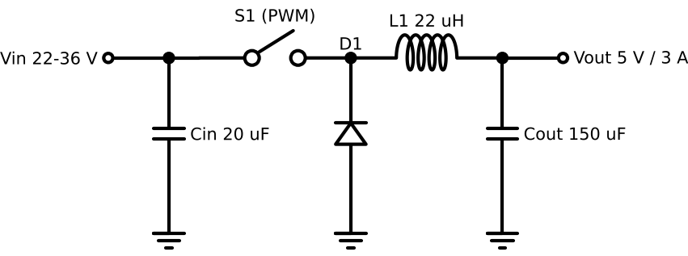
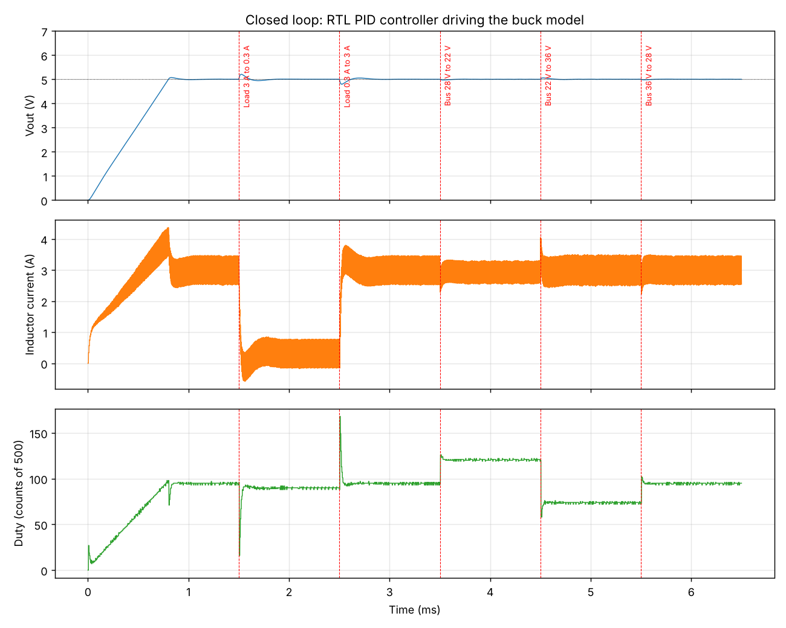
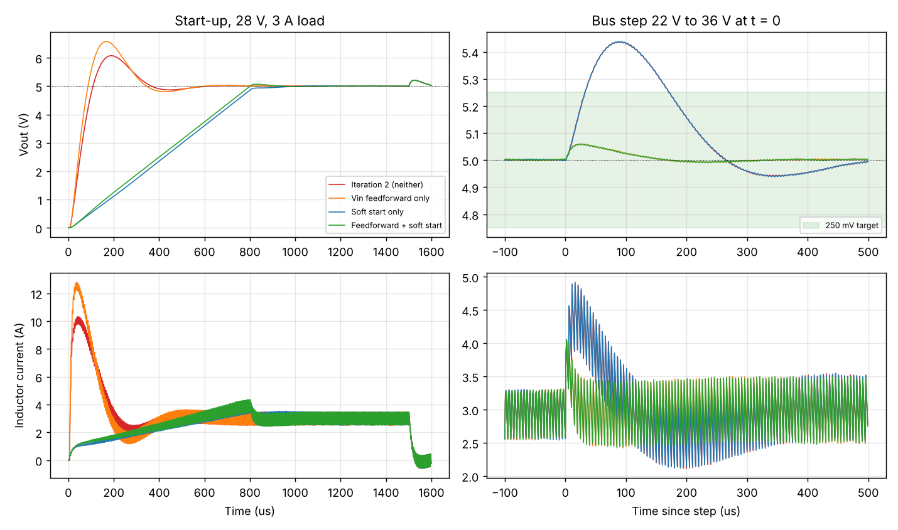
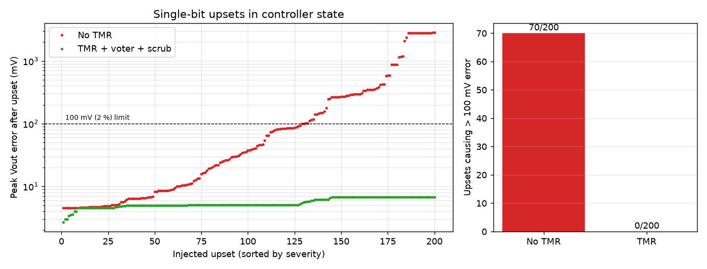

# Spacecraft 28 V Bus Buck Converter: power stage, digital control and radiation-tolerant controller

Simulation study of a 28 V (22 to 36 V) to 5 V / 3 A buck converter for a spacecraft power bus.
It covers three things in one repo:

1. **Power stage design** in SPICE (LTspice / ngspice): component sizing, corner analysis, derating.
2. **Digital control in Verilog**: fixed-point PID voltage-mode controller with Vin feedforward and soft start, and a PWM generator, written as synthesisable RTL and checked in simulation against a bit-exact Python model.
3. **Single-event-upset (SEU) tolerance**: triple modular redundancy (TMR) with a majority voter and per-period scrubbing, tested by injecting 200 random bit flips into the controller state.

**Status: simulation only.** No hardware has been built and the RTL has not been synthesised for an FPGA yet (see "Limitations" and "Next steps").



## Headline results

| Item | Result |
|---|---|
| Efficiency, 3 A load, 22 to 36 V in (SPICE, conduction losses only) | 91.1 to 92.4 % |
| Output ripple, worst case across 18 corners (SPICE) | 18 mV pk-pk |
| Steady-state regulation, closed loop (Verilog sim) | 5.002 V |
| Phase / gain margin, worst case (frequency response of the loop) | 46 deg / 7.2 dB |
| Settling after load step | 226 to 229 us (to +/-50 mV) |
| Settling after line step | 0 to 49 us (to +/-50 mV; two of three line steps never leave the band) |
| Step excursion, load steps | 203 to 207 mV (target 250 mV) |
| Step excursion, line steps (28 to 22 V, 22 to 36 V, 36 to 28 V) | 31 / 60 / 23 mV (target 250 mV) |
| Start-up with 0.8 ms soft start | 73 mV overshoot, 4.4 A peak inductor current |
| RTL vs Python golden model | 1299 / 1299 control ticks identical |
| Bit-flip faults causing > 100 mV error, **no TMR** | 69 / 200 (worst case 5.7 V) |
| Bit-flip faults causing > 100 mV error, **with TMR** | 0 / 200 |

Iteration history. Iteration 1 used a 47 uF output capacitor and had 430 to 1010 mV step excursions. Iteration 2 raised it to 150 uF and retuned the PID, which fixed the load steps but left two problems: the 22 to 36 V line step gave 438 mV (target 250 mV), and start-up overshot by 1.08 V with a 10.3 A inrush peak because there was no soft start. Iteration 3 adds Vin feedforward (line step 438 mV down to 60 mV) and a soft start ramp (start-up overshoot 1079 mV down to 73 mV, inrush 10.3 A down to 4.4 A). `docs/test_report.md` has the before and after, and `results/ablation_summary.md` shows each fix on its own.

Fault injection caveat: without TMR the new controller looks about the same as iteration 2 (69 / 200 flips above 100 mV against 57 / 200 on the same flips; 34 / 156 against 33 / 165 if you drop upsets that landed while the previous one was still recovering). It does gain one specific weak spot, the soft start reference register: clearing bit 11 or bit 9 of it restarts the ramp and pulls Vout down by up to 4.5 V. TMR still stops all 200 upsets. The no-TMR counts are rough, because the injections run back to back and some start before the previous upset has recovered.





## Repository layout

```
spice/      buck_open_loop.cir, buck_load_step.cir   power stage netlists (LTspice and ngspice)
rtl/        pwm_gen.v, pid_ctrl.v, tmr_voter.v, buck_ctrl_top.v   synthesisable Verilog
tb/         buck_plant.v, tb_buck_loop.v, tb_fault_inject.v       testbenches (not synthesisable)
scripts/    run_spice.py, tune_pid.py, loop_margins.py, golden_model.py, plot_results.py, ablation.py, draw_schematic.py
docs/       design_note.md, test_report.md, schematic.png
results/    plots, CSV logs and auto-generated summary tables
```

## How to run

Needs: Icarus Verilog (`iverilog`, `vvp`), ngspice, Python 3 with numpy, scipy, matplotlib, schemdraw.

```
pip install -r requirements.txt
make sim golden        # closed-loop simulation + bit-exact check (seconds)
make fault             # 2 x 200 fault injections (about 40 s)
make ablate            # feedforward / soft start on and off, plus fault runs on the old controller (about 1 min)
make plots             # figures and tables in results/
make spice             # SPICE corner sweep (about 3 min)
make all               # everything
```

Open `spice/buck_open_loop.cir` directly in LTspice (File > Open, then Run) to see the power stage waveforms. Waveforms from the Verilog run can be viewed from `results/loop_log.csv`.

## How it works, briefly

* The Vout and Vin ADC codes are sampled once per switching period (200 kHz). The controller computes the new duty in one clock cycle and applies it to the next period.
* PID: `e = ref - adc`, integrator with clamping anti-windup, derivative on error, all in integer maths with gains scaled by 2^16. Gains were tuned on an averaged model (`scripts/tune_pid.py`) for at least 45 degrees of phase margin at every Vin and load corner (`scripts/loop_margins.py`).
* Vin feedforward: a buck has `Vout = D * Vin`, so the duty for the wanted output is `D = Vout / Vin`. The controller computes that from the measured Vin (`ff = ref * PERIOD * VIN_CPV / (ADC_CPV * vin)`, clamped to the duty limit) and adds it to the PID output. A bus step then moves the duty at the next tick instead of waiting for an error to build up, and the PID only trims the leftover (diode and DCR drops). It sits outside the feedback loop, so the loop margins from `scripts/loop_margins.py` do not change.
* Soft start: the reference starts at 0 and rises 16 ADC codes (31 mV) per switching period until it reaches 5 V, a ramp of 0.8 ms. The same ramped reference feeds both the error and the feedforward. `SS_STEP = 0` turns it off.
* With `FF_EN = 0` and `SS_STEP = 0` the RTL gives the iteration 2 waveform bit for bit, which is how the before and after numbers are made.
* TMR: the 70-bit controller state (soft start reference, integrator, previous error, duty) is stored three times. Every read goes through a bitwise 2-of-3 voter, and the voted next state is written back to all three copies every period, so a single upset is both masked and scrubbed. A mismatch flag is raised for telemetry.
* Fault injection: a random bit of a random copy is flipped at a random time, then Vout is watched for 300 us. The same bit and time sequence is replayed with TMR off and on.

## Limitations (please read)

* **Simulation only.** No PCB, no hardware, no FPGA synthesis or timing report yet.
* The SPICE power stage uses an ideal switch plus a Schottky diode and has **no switching losses or gate-drive loss**, so efficiency is optimistic. Most of the loss is diode conduction, so a synchronous rectifier should help (not simulated).
* The Verilog loop simulation uses a behavioural synchronous buck (forced continuous conduction, inductor current can go negative). It does not model discontinuous mode, ADC noise, ESR or temperature drift of parts.
* Fault injection flips bits in the controller state only. It does not model upsets in the PWM counter, ADC path, clock, configuration memory, or multiple-bit upsets between scrubs. Real radiation tolerance also needs part selection and testing, which this repo does not cover.
* There is no output over-voltage protection, so an uncorrected upset lets Vout rise far past 5 V in the model (5.7 V worst case). A real design needs an independent OVP.
* The Vin sense is ideal in the model (no noise, no filter, no ADC error beyond rounding to 10 mV) and the bus steps are instantaneous. A real feedforward path needs a filter and will see Vin ripple and measurement error, which the integrator then has to trim.
* The feedforward divide is a 48-bit combinational `/` in the RTL. It simulates and should synthesise, but it would be slow and large on an FPGA. A real version would use a multi-cycle divider or a reciprocal table. Not synthesised or timed.
* A bit flip in the soft start reference register (bit 11 or 9, which are set at 5 V) restarts the ramp from a lower value, which dips Vout. TMR masks it, but without TMR this register is a new weak spot.
* The fault injection runs upsets back to back, so without TMR some start while the previous upset is still recovering. This is also true of the iteration 2 numbers.
* The 22 to 36 V bus range and 5 V / 3 A load are assumptions chosen for this study, not taken from a specific mission standard.

## Next steps

1. Replace the diode with a synchronous rectifier and re-run efficiency.
2. Synthesise `rtl/` for a small FPGA (for example iCE40 with yosys/nextpnr, or Xilinx Vivado) and report resource use and timing. Replace the combinational feedforward divide first.
3. Add a filter and noise to the Vin sense path and re-check the line step.
4. Add a hardware-in-the-loop version with a prototype board.
5. Add an independent OVP comparator.

## Licence

MIT. See `LICENSE`.
